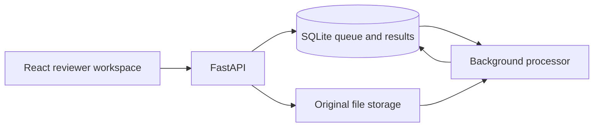

# Architecture outline

Keep original files outside the static frontend directory. Store job state, extracted invoices, history and search indexes in SQLite. Use a separate background worker for parsing and OCR, and retain an audit record for reviewer corrections.
