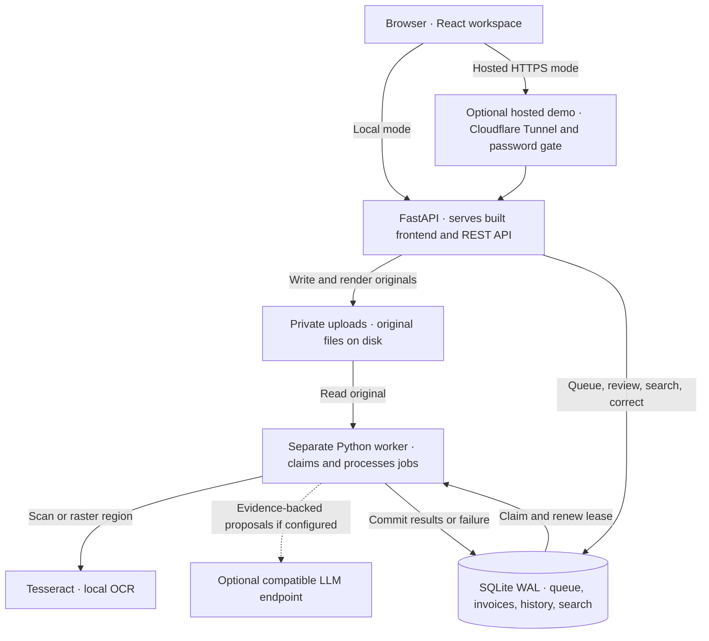
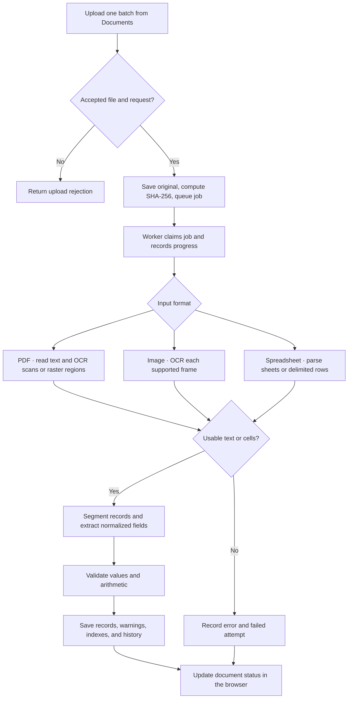
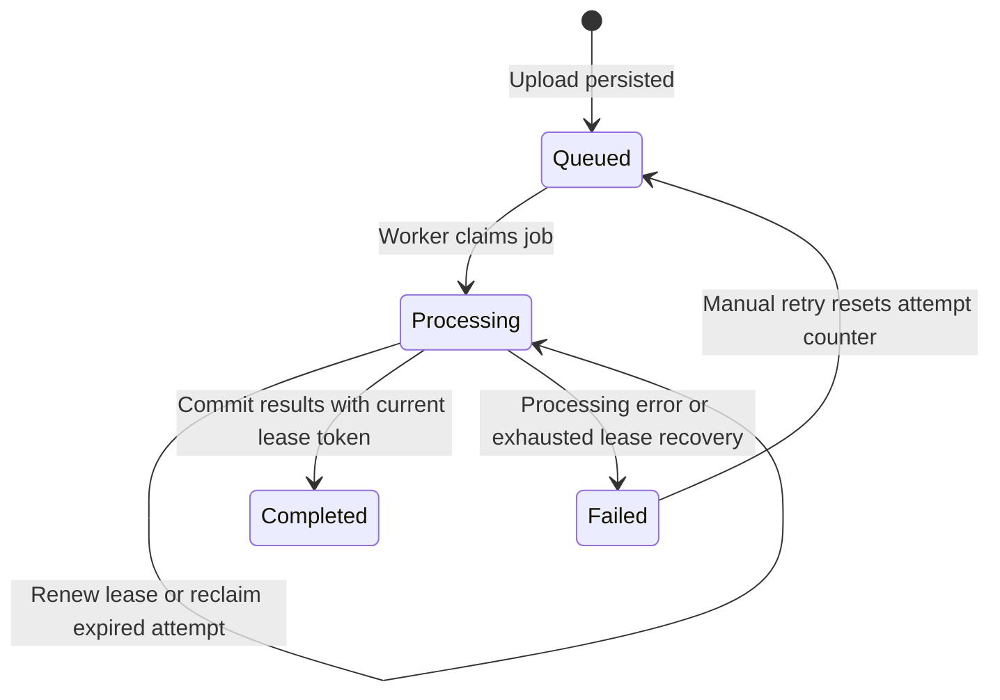
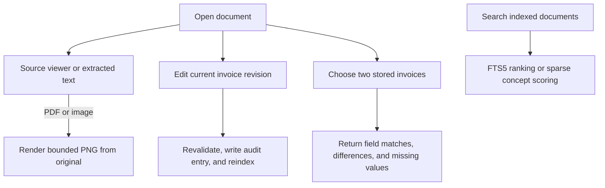
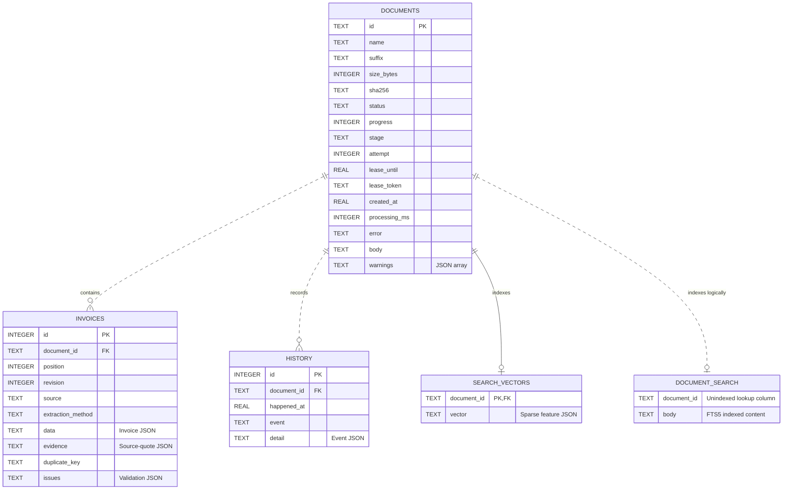

# Ledger Review architecture and database schema

Ledger Review accepts financial documents, processes them in a background worker, and gives reviewers a browser workspace for source inspection, corrections, search, and reconciliation.

## 1. System architecture

The API and worker use the same data directory. Original uploads are outside the static web directory. Local development runs one API process and one worker process. Docker Compose defines separate services with a shared volume. The hosted demo uses an isolated data store and a temporary tunnel. It has a shared password and no per-user database authorization.

## 2. Upload to completed document

Digital PDFs retain selectable text. The OCR path handles scans and image regions on mixed pages. Spreadsheet parsers work from stored cell values. Readable pages can still produce a result when another page emits a warning. The model path is optional. Accepted proposals require source quotes, and uncertain values can remain empty. Validation checks numeric values, missing fields, and financial arithmetic. Duplicate flags are calculated when invoice details are read using the normalized supplier and invoice number.

## 3. Job lifecycle and recovery

The lease lasts 90 seconds and has a 20-second heartbeat. Progress updates can renew it too. A valid lease token guards completion and failure writes. Expired jobs can be reclaimed, and an expired job that has reached three attempts is marked failed. Upload, processing, completion, failure, retry, and correction events are recorded in history.

## 4. Browser workflows and data paths

| Interaction | API and behavior |
|---|---|
| Upload and queue | `POST /api/documents` returns per-file intake results. `GET /api/documents` reports status and progress. |
| Inspect | `GET /api/documents/{id}` returns status, the first invoice page, warnings, and history. More invoices are available under `/invoices`. |
| View evidence | `GET /api/documents/{id}/text` pages extracted text. `GET /api/documents/{id}/preview/{page}` renders a bounded PNG and supports rotation. |
| Correct | `PATCH /api/invoices/{id}` checks the revision, validates the submitted values, updates records and search indexes, and writes before-and-after values to history. |
| Reconcile | `GET /api/reconcile` compares two invoice IDs, including PDF-to-PDF and PDF-to-Excel pairs. It reports field differences and a supplier-plus-invoice-number identity check. |
| Search | `GET /api/search` uses SQLite FTS5 for keywords or cosine-style scoring over normalized sparse lexical and financial concept features. |
| Retry and health | `POST /api/documents/{id}/retry` requeues a failed document. `GET /api/health` checks database connectivity. |

## 5. Database schema

| Schema detail | Implementation |
|---|---|
| Invoice identity within a file | `UNIQUE(document_id, position)`. |
| Foreign keys | `invoices`, `history`, and `search_vectors` reference `documents.id` with cascade deletion. The FTS5 link is maintained by indexing code and has no declared foreign key. |
| Supporting indexes | Jobs by `(status, created_at)`, invoices by document and duplicate key, and history by `(document_id, id)`. |
| Invoice JSON | Invoice number, invoice date, supplier, customer, subtotal, tax, total, currency, and a line-item array with description, quantity, unit price, and amount. Decimal values use strings. |
| File storage | The original is stored as `uploads/<document_id><suffix>`. It is referenced by the metadata row and is outside SQLite. |

The authoritative DDL is [app/schema.sql](../app/schema.sql). The request paths are implemented in [app/main.py](../app/main.py), and the lease and processing behavior is in [app/worker.py](../app/worker.py).
