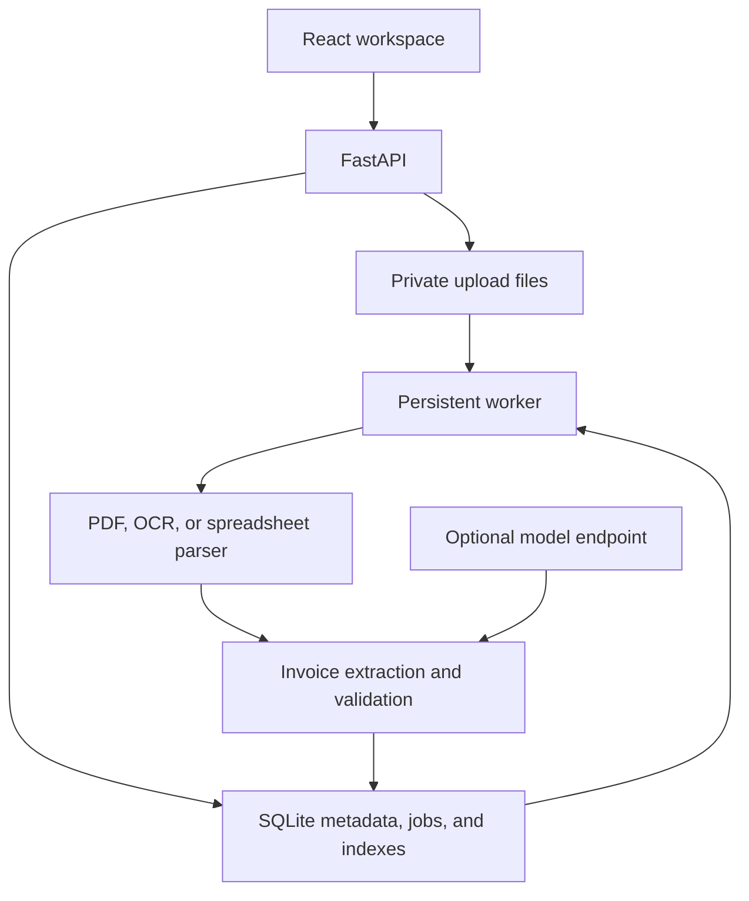
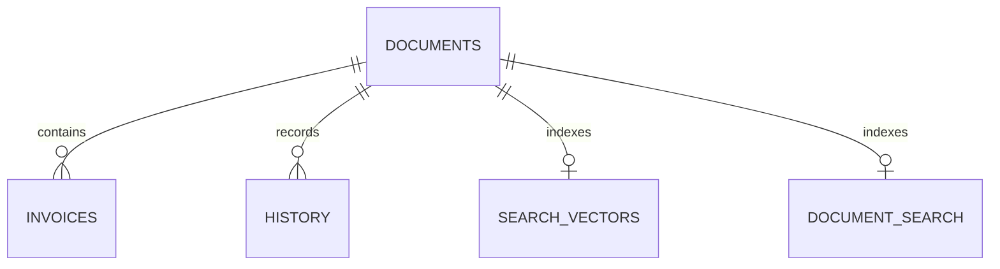

# Architecture and database schema

Each upload is copied in bounded chunks and hashed before inserting a queued job. The worker claims queued or expired jobs inside a write transaction. Its lease is renewed during processing, and a unique token prevents an expired worker from publishing stale output. Each completed job stores the invoice records, source text, search indexes, and completion event in one transaction. Failed runs keep history and can be retried through the API.

Text sections preserve their page or sheet origins. The extractor returns decimal values as strings for exact calculation. Model assistance is opt-in and requires evidence for proposed values. Review flags distinguish uncertainty, arithmetic mismatches, duplicates, and incomplete line items. Corrections are version-checked, recalculate the invoice's flags, and update the search index and correction history.

| Table | Main fields | Notes |
|---|---|---|
| `documents` | ID, original name, suffix, bytes, SHA-256, status, stage, progress, attempt, lease, source text, warnings, error, timing | Also acts as the durable queue. |
| `invoices` | ID, document ID, position, revision, source, extraction method, JSON fields, evidence, issues, duplicate key | Supplier and number are normalized for duplicate detection. |
| `history` | ID, document ID, timestamp, event, detail | Includes before and after values for corrections. |
| `document_search` | Document ID, indexed text | FTS5 index over source and extracted/corrected values. |
| `search_vectors` | Document ID, sparse vector JSON | Cosine scores over lexical features and domain synonyms. |

The exact [SQL schema](../app/schema.sql) includes foreign keys, job and invoice indexes, and ordering constraints. Uploaded file bytes are stored outside the static asset directory.
