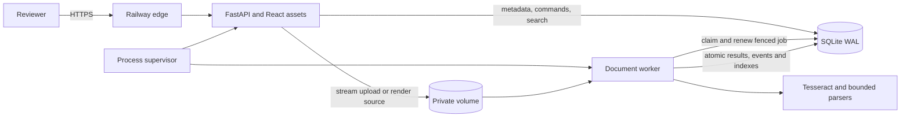
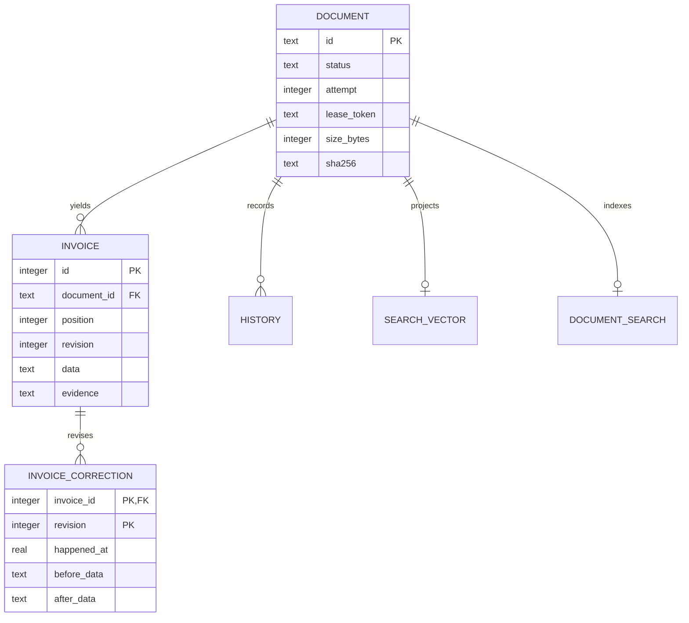
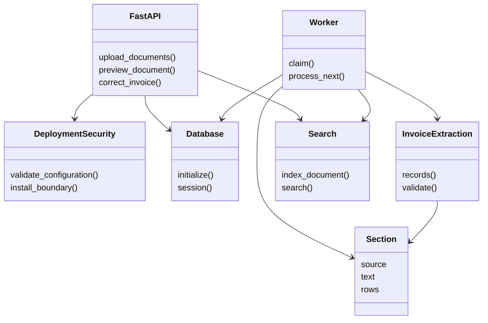

# Ledger Review system design

Ledger Review is a reviewer workspace for financial document intake, evidence-backed extraction, validation, search, correction, and reconciliation. The Railway assessment environment is a password-protected, single-workspace demo for synthetic documents. Capacity for independent organizations requires per-tenant authorization, private object storage, and a managed database and job queue.

## System architecture

## System behavior

1. The API authenticates the reviewer and checks the browser's origin for writes. Uploads are bounded before multipart parsing and counted against the workspace quota before a job is accepted.
2. The API writes each input under a generated identifier. The table entry and upload event commit together. A bounded batch can return both accepted and rejected files.
3. The worker leases one job at a time. It extracts digital text, parses spreadsheets or invokes OCR, normalizes fields, validates Decimal arithmetic, and writes the document result, invoices, search projections, and history in one transaction. The lease token prevents an old worker from publishing after recovery.
4. The reviewer can inspect source pages and evidence, correct an invoice at a known revision, and compare explicit records across documents. A conflicting revision returns 409. Corrections retain before/after snapshots in a dedicated table.
5. A failed job can be retried within its attempt budget. Recovery can reclaim an abandoned job after lease expiry. SQLite and uploads share one persistent volume. A supervised worker process and API share a deployment lifecycle.

## Enhanced entity-relationship model

An invoice is a document-dependent entity, unique by document and position. A correction is identified by invoice and revision. Source formats share a single document lifecycle, with the extension selecting an adapter. Invoice line items and field evidence are structured snapshots inside the invoice JSON. This keeps extraction and correction atomic and avoids joining a separate table for values always edited together. The FTS index and concept vector are derived projections, not authoritative financial records.

## Backend class and module design

Module names in the diagram describe responsibilities implemented as Python functions. FastAPI request models validate incoming correction payloads; parser adapters return the shared Section data class.

## Deployment decisions

Railway terminates HTTPS. One replica serves the UI and API and supervises the worker with the same mounted data directory. The demo disables outbound model use. Local mode can still opt into a configured model, which receives extracted text. Deployments with a shared reviewer credential must use synthetic data. Multi-replica work, managed retention, separate identity, isolated preview rendering, and restore drills are requirements for a live financial-data service.

See [backend contracts](BACKEND.md), [storage and schema design](SCHEMA.md), [schema DDL](../app/schema.sql), and [threat model](SECURITY.md).
